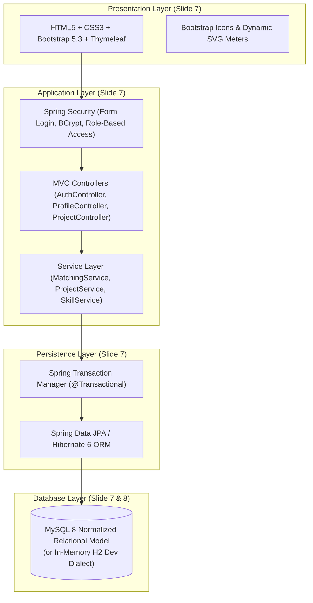
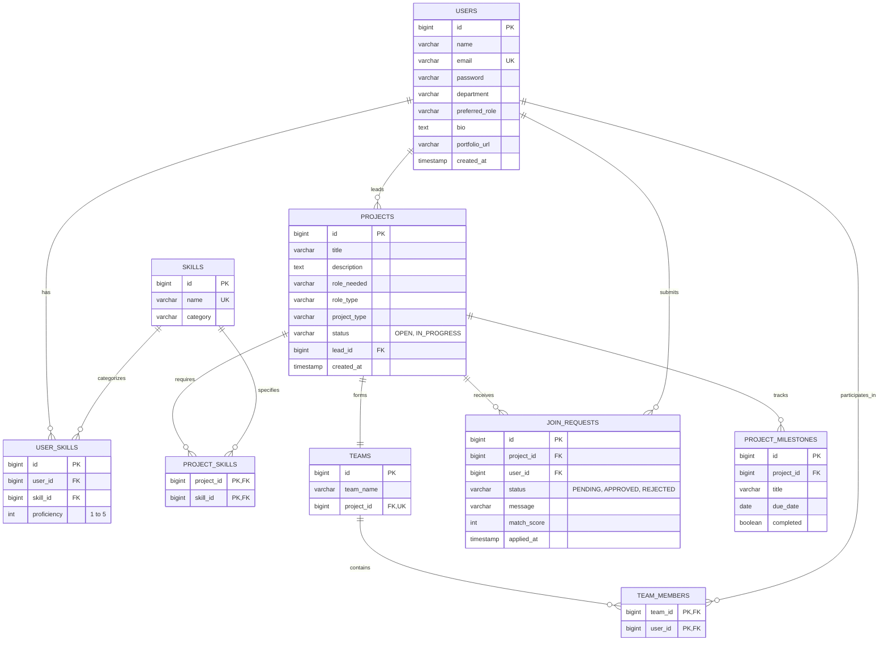

# SkillBridge: DBMS & Full-Stack Mini Project Report

**Project Title:** SkillBridge – Campus Team Formation and Skill Matching Platform  
**Technology Stack:** Java 21+, Spring Boot 3.3.5, Spring Data JPA / Hibernate, MySQL 8, Spring Security, Thymeleaf, Bootstrap 5.3  
**Mini Project Category:** Java + DBMS Mini Project  

---

## 1. Executive Summary & Problem Context

Great campus projects, hackathons, and research initiatives frequently fail to launch or struggle due to team misalignment:
- **Skills are difficult to discover** across disparate departments (Computer Science, Data Science, Design, Media).
- **Teams lack balanced functional roles** (e.g., projects with three backend developers and no UI designer).
- **No transparent application workflow** with referential and transactional integrity.

**SkillBridge** solves this with a normalized relational database and an explainable, rule-based matching engine that ranks candidates by skill fit while ensuring atomic team formation.

---

## 2. System Architecture (Presentation to Database)



---

## 3. Database Design & Entity-Relationship (ER) Model (Slide 8)

The schema follows third normal form (3NF) and Boyce-Codd normal form (BCNF), utilizing primary keys, foreign keys, cascade policies, and integrity checks.



---

## 4. Normalization Analysis

1. **First Normal Form (1NF)**:
   - All attributes are atomic (no arrays or comma-delimited fields stored in table columns).
   - Multi-valued attributes (skills of a user, required skills of a project, members of a team) are factored into dedicated junction tables (`user_skills`, `project_skills`, `team_members`).
   - Every table has a primary key (`id` or composite `(project_id, skill_id)`).

2. **Second Normal Form (2NF)**:
   - The relations are in 1NF.
   - All non-key attributes are fully functionally dependent on the entire candidate key.
   - For instance, in `user_skills(id, user_id, skill_id, proficiency)`, `proficiency` depends solely on the pairing of the user and the skill.

3. **Third Normal Form (3NF)**:
   - The relations are in 2NF.
   - There are no transitive dependencies: $X \to Y \to Z$ where $Z$ is a non-prime attribute.
   - In `projects`, attributes such as `lead_id` reference `users(id)`; lead details (`name`, `department`) are stored in `users`, preventing redundant anomaly-prone storage.

4. **Boyce-Codd Normal Form (BCNF)**:
   - For every non-trivial functional dependency $X \to Y$, $X$ is a superkey.

---

## 5. Transparent Rule-Based Skill Matching Algorithm (Slide 6)

SkillBridge implements explainable matching rather than opaque black-box heuristics:

### Basic Overlap Score Formula
$$\text{Basic Score} = \text{round}\left(100 \times \frac{|\text{Required Skills} \cap \text{Candidate Skills}|}{|\text{Required Skills}|}\right)$$

*Slide 6 Case Study*:
- Required Skills: `{ Java, MySQL, JDBC }` ($N=3$)
- Candidate Skills: `{ Java, MySQL }` ($M=2$)
- $\text{Basic Score} = \text{round}(100 \times \frac{2}{3}) = \mathbf{67\%}$

### Proficiency-Weighted Scoring
To differentiate between a novice and an expert who both list "Java", the engine applies a calibrated weighting factor $w(p)$ where $p \in [1, 5]$:

$$w(p) = \begin{cases} 
0.60, & p = 1 \text{ (Novice)} \\
0.75, & p = 2 \text{ (Basic)} \\
0.85, & p = 3 \text{ (Intermediate)} \\
0.95, & p = 4 \text{ (Advanced)} \\
1.00, & p = 5 \text{ (Expert)}
\end{cases}$$

$$\text{Weighted Score} = \min\left(100, \text{round}\left(100 \times \frac{\sum_{s \in \text{Matched}} w(p_s)}{|\text{Required Skills}|}\right)\right)$$

This accounts for the realistic student candidate rankings depicted in Slide 4:
- **Aarav Sharma**: 92% (High proficiency across Java, Spring, SQL)
- **Neha Gupta**: 87% (Solid proficiency across Java, DBMS, APIs)
- **Rohan Verma**: 76% (Proficient in JDBC and MySQL)

---

## 6. Transactional Integrity & ACID Guarantees

In team formation, inconsistency can occur if an application is approved but adding the member fails (or vice versa).

SkillBridge enforces strict transactional integrity using Spring `@Transactional`:
```java
@Transactional
public Long decide(Long requestId, User actor, boolean approve) {
    JoinRequest r = requests.findById(requestId).orElseThrow();
    Project p = r.getProject();
    if (!p.getLead().getId().equals(actor.getId())) {
        throw new AccessDeniedException("Only the project lead can do this");
    }
    if (r.getStatus() != JoinRequest.Status.PENDING) return p.getId();
    
    if (approve) {
        r.setStatus(JoinRequest.Status.APPROVED);
        p.getTeam().getMembers().add(r.getUser()); // Added to team in SAME transaction
    } else {
        r.setStatus(JoinRequest.Status.REJECTED);
    }
    return p.getId();
}
```
- **Atomicity**: Either both state updates succeed, or the entire operation rolls back.
- **Consistency**: Unique constraint `(project_id, user_id)` on `join_requests` prevents duplicate applications.
- **Isolation**: Standard repeatable-read / read-committed database transaction isolation.
- **Durability**: Upon commit, relational records are persisted to disk.

---

## 7. Verification & Test Suite Summary

A total of **20 automated test cases** are verified using JUnit 5 and Spring MockMvc:

1. `MatchingServiceTest` (7 tests):
   - Two-of-three requirements yields exactly 67% (Slide 6 verification).
   - 100% full match, 0% disjoint match, empty requirements edge case.
   - Lead exclusion and descending candidate ranking.
   - Proficiency weighting differential validation.
   - Explanation generation for matched vs. missing skills.

2. `ProjectServiceTest` (6 tests):
   - Project creation auto-creates team entity with lead as first member.
   - Lead cannot apply to their own project.
   - Valid join request creation with custom message and match score.
   - Atomic approval inserting member into `team_members`.
   - Rejection updating status without modifying team membership.
   - Access control rejection (`AccessDeniedException`) when non-leads attempt decisions.

3. `SkillServiceTest` (3 tests):
   - CSV token parsing with automatic whitespace trimming.
   - Case-insensitive skill deduplication (`"Java"` vs `"java"`).
   - Graceful handling of null/empty strings.

4. `ProjectControllerIntegrationTest` (4 tests):
   - Public routing for home (`/`) and login (`/login`).
   - Unauthenticated redirection on secured endpoints (`/projects`).
   - Full authenticated user access to `/dashboard` and `/projects`.
